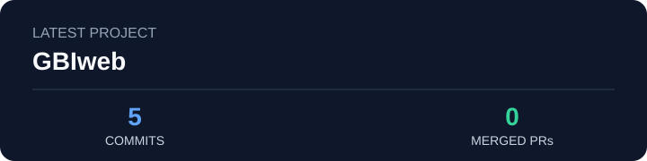

<!-- Profile README for @Irfanslamet -->

  

  

 

## 👋 About Me

I'm an **Informatics Engineering student at Universitas Teknologi Bandung** with a strong interest in building modern, reliable, and user-focused digital products.

My main focus is **full-stack web development**, where I work across both frontend and backend to turn ideas into functional applications. I also enjoy exploring **mobile app development**, especially with Kotlin, giving me the flexibility to build experiences across different platforms.

I believe great software is not only about writing code, but also about understanding problems, designing thoughtful solutions, and continuously improving through learning and collaboration.

- 🔭 Currently focused on full-stack web development and product-oriented projects
- 🌱 Continuously learning about scalable architecture, clean code, and modern development practices
- 💡 Interested in web applications, mobile apps, developer tools, and impactful technology
- 📍 Based in Indonesia

## 🛠️ Technologies & Tools

### Frontend

### Backend & Database

### Mobile & Development Tools

## 🚀 What I Build

- Responsive and interactive web applications
- Full-stack systems with RESTful APIs and relational databases
- Clean, maintainable, and type-safe application code
- Mobile applications using Kotlin
- Practical digital solutions that solve real-world problems

## 📊 Latest Project Statistics

  

## 🤝 Let's Connect

I'm always open to learning, collaborating, and working on meaningful projects. Feel free to explore my repositories and connect with me through GitHub.

  

 

  <i>"Build with purpose. Learn continuously. Create impact."</i>

